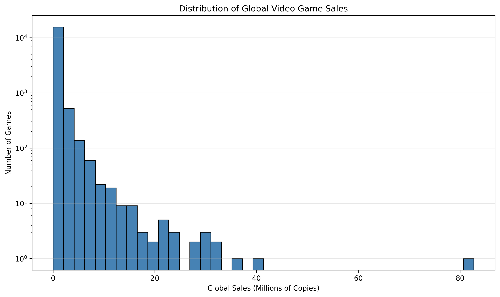

# Video Game Sales Analysis Using Python

## Project Overview

This project explores historical video game sales data using Python. The main objective is to discover patterns in global video game sales and understand how sales differ across genres, platforms, and release years.

I used Pandas for data cleaning and manipulation, NumPy for numerical operations, and Matplotlib to create visualizations.

## Dataset

**Source:** [Video Game Sales Dataset — Kaggle](https://www.kaggle.com/datasets/gregorut/videogamesales)

The original dataset contains 16,598 records and 11 columns.

The dataset includes information about video game titles, platforms, release years, genres, publishers, and sales across different regions.

Sales are measured in millions of copies.

## Research Questions

1. Which video game genres have the highest global sales?
2. Which platforms have the highest total game sales?
3. How do total recorded sales vary by release year?
4. What are the top 10 best-selling video game records?
5. What can descriptive statistics tell us about video game sales?

## Tools and Libraries

- Python
- Pandas
- NumPy
- Matplotlib
- Google Colab

## Data Cleaning

I inspected the dataset for missing values, duplicates, and incorrect data types.

The cleaning process included:

- Identifying 271 missing values in the Year column.
- Removing records with missing release years.
- Replacing missing Publisher values with "Unknown".
- Checking for duplicate rows.
- Converting Year from a floating-point value to an integer.
- Checking the sales columns for negative values.

After cleaning, the dataset contained **16,327 records**.

## Data Manipulation

I performed three data manipulation operations:

**Sorting:** I sorted games by global sales to identify the 10 best-selling records.

**Filtering:** I filtered games released in 2010 or later to analyze a more recent subset of the historical dataset.

**Grouping:** I grouped records by genre, platform, and release year to calculate total global sales for each category.

These operations helped me organize the data and identify meaningful sales patterns.

## Data Visualizations

### 1. Global Video Game Sales by Genre

Action games generated the highest total global sales, with approximately 1,722.88 million copies, followed by Sports games with 1,309.24 million copies.

### 2. Top 10 Platforms by Global Video Game Sales

PlayStation 2 had the highest total recorded game sales, with approximately 1,233.46 million copies.

### 3. Global Video Game Sales by Release Year

This chart compares the total recorded global sales of games grouped by release year. These values should not be interpreted as annual industry revenue or annual sales transactions.

### 4. Top 10 Best-Selling Video Games

Wii Sports was the best-selling game record in the dataset, with approximately 82.74 million copies sold worldwide.

### 5. Distribution of Global Video Game Sales

The distribution shows that most game records have relatively low sales, while a small number have exceptionally high sales.

## Statistical Analysis

I calculated descriptive statistics to better understand global video game sales.

| Statistic | Result |
|---|---:|
| Number of records | 16,327 |
| Mean global sales | 0.54 million |
| Median global sales | 0.17 million |
| Standard deviation | 1.57 million |
| Maximum global sales | 82.74 million |
| Minimum global sales | 0.01 million |

The mean is considerably greater than the median, suggesting a right-skewed distribution.

The standard deviation also indicates substantial variation in sales across game records.

These results suggest that a relatively small number of highly successful games achieve much greater sales than a typical game.

## Key Findings

- Action was the highest-selling genre based on cumulative global sales.
- PlayStation 2 had the highest total game sales among the platforms.
- Wii Sports was the best-selling individual record in the dataset.
- Game Boy had one of the highest average sales figures per game record.
- Mean sales were significantly higher than median sales, indicating that top-selling games influenced the overall average.

## Limitations

The dataset is historical and does not include all recent video game releases.

Some records were removed because their release years were missing. This may affect comparisons between years.

The analysis uses estimated sales figures reported in the dataset, not live sales data.

The dataset may contain separate records for the same title released on different platforms. Therefore, record-level results should not automatically be interpreted as totals for unique game titles.

## Conclusion

This project demonstrates how Python can be used to clean, manipulate, visualize, and analyze a real-world dataset.

By using Pandas and Matplotlib, I identified differences in video game sales across genres, platforms, and individual titles.

The results show that global video game sales are highly uneven, with a small number of successful games accounting for exceptionally high sales compared with a typical game.

This project helped me practice essential data analytics skills, including data cleaning, grouping, filtering, visualization, and statistical interpretation.
